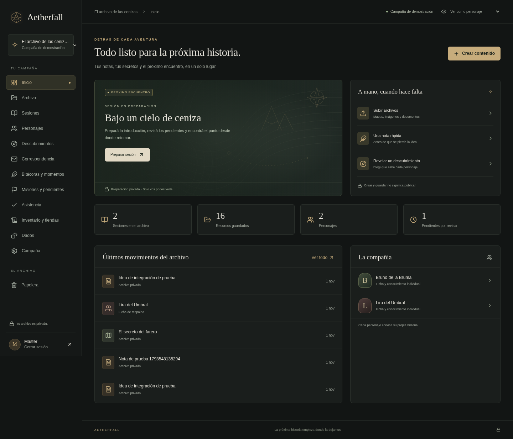

# Aetherfall

Archivo privado y memoria de una campaña presencial de rol. Next.js, TypeScript, PostgreSQL, Auth.js y tu Google Drive privado como almacenamiento central. **No utiliza Supabase.**

La aplicación funciona en desarrollo con PostgreSQL nativo y archivos locales. En Vercel exige PostgreSQL externo y tu Drive autorizado; el modo local queda deshabilitado en producción. No está desplegada ni vinculada automáticamente al dominio proporcionado.

## Empezar en desarrollo

Requisitos: Node.js 24, npm y un sistema compatible con los binarios locales de PostgreSQL. Los comandos de abajo fueron probados en Linux x64. Usá el checkout existente; no hace falta crear un worktree.

```sh
npm ci
npm run local:setup
npm run local:prepare
```

`local:setup` crea `.env.local` ignorado por Git, con claves aleatorias para desarrollo. Conserva archivos existentes. `local:prepare` inicia PostgreSQL cuando hace falta, aplica migraciones, carga exclusivamente la campaña ficticia y detiene solo el proceso que inició. Puede repetirse sin borrar datos.

En tres terminales separadas:

```sh
npm run db:local
npm run mail:local
npm run dev
```

El buzón local **no envía correo a Internet**: solo acepta `@example.test`. Los correos quedan en `.local/mail/`, con permisos privados. Para probar el acceso, ingresá `master@example.test`, `lira@example.test` o `bruno@example.test` y abrí el enlace del correo correspondiente en el buzón local. No compartas esos enlaces. También podés ejecutar las pruebas automáticas de navegador, que realizan este proceso sin mostrar los tokens.

La demostración es una campaña ficticia separada. No hay cuentas inventadas para los jugadores reales. Para inicializar tu campaña, con la base de destino correcta configurada:

```sh
npm run bootstrap -- TU_CORREO_REAL
```

Este comando crea Aetherfall / La Banda Viajera, sus carpetas y únicamente los nombres aportados en la especificación. Las fichas están vacías, sin propietarios y privadas hasta revisión. No envía correos. Se ejecuta una sola vez por campaña.

## Verificación

Con PostgreSQL local, buzón y aplicación iniciados:

```sh
npm run typecheck
npm test
npm run test:postgres
npm run test:e2e
npm run build
```

- `test`: pruebas de dominio en un PostgreSQL WASM aislado y temporal; no necesita el servidor local.
- `test:postgres`: misma suite contra PostgreSQL nativo real, en una base de prueba recién creada que se elimina al terminar. Incluye compras simultáneas, idempotencia, permisos y restauración.
- `test:e2e`: Chromium, acceso real por enlaces de un uso y operaciones HTTP/UI con máster y dos jugadores. Por defecto usa `/usr/bin/chromium`; se puede seleccionar con `CHROMIUM_PATH`. Usa solamente datos ficticios y deja entradas de prueba en la campaña de demostración.
- `build`: compilación de producción; no necesita conexiones externas durante la compilación. Para ejecutar esa compilación se necesitan los servicios externos, o PostgreSQL real y carpetas de Drive de pruebas autorizadas (o un S3 privado de pruebas). `next start` no habilita el almacenamiento local.

## Conectar tu Google Drive

Seguí la [guía de conexión de Google Drive](docs/google-drive.md). La integración está preparada, pero requiere tu consentimiento de Google y variables de servidor. No conectes el Drive personal a las pruebas automáticas: la demostración usa archivos locales y las pruebas lo verifican antes de escribir.

## Qué incluye esta entrega

- Invitaciones por campaña y cuentas individuales mediante enlaces de acceso de 15 minutos, de un uso. Recuperación mediante nuevo enlace y revocación de miembros en cada solicitud.
- Panel del máster, archivo, carpetas anidadas, búsqueda autorizada, bandeja sin clasificar, etiquetas en datos complementarios, enlaces, papelera y restauración.
- Sesiones con preparación, introducción, resumen, cierre y punto de retorno independientes. Fragmentos revelados por personaje, con origen del conocimiento y revocación.
- Fichas de respaldo, propietario, campos habilitados por máster, notas privadas separadas, versiones, conflictos e impresión.
- Adjuntos originales privados: PNG, JPEG, WebP, PDF y texto UTF-8. Subida múltiple secuencial, validación de firma/tamaño, prevención de duplicados y autorización antes de descargar.
- Asistencia privada y registro manual de continuidad. Bitácoras, intenciones y momentos privados con acciones explícitas para compartir; correspondencia privada con borradores, envío interno y respuestas configurables.
- Misiones, pendientes, NPC, villanos, reliquias e ideas como entradas privadas, con estados separados. Las propuestas no modifican el canon automáticamente.
- Monedas configurables en unidades exactas, inventario individual, entregas, consumo y transferencias del máster, catálogos por personaje, compras solicitadas y confirmación atómica e idempotente.
- Dados privados generados en el servidor, historial y ventaja/desventaja.
- API opcional con credenciales acotadas y revocables. Crear borradores nunca publica contenido.
- Respaldo con originales, relaciones e historial y restauración verificada en una base aislada.

**No equivale a completar todos los módulos de la especificación.** Consultá [estado y pendientes](docs/estado.md) antes de usarlo con datos reales.

## Documentación

- [Especificación original completa](docs/especificacion-original.txt)
- [Arquitectura y modelo de datos](docs/arquitectura.md)
- [Matriz de permisos](docs/permisos.md)
- [Guía de máster y jugador](docs/guia.md)
- [Despliegue en Vercel](docs/despliegue.md)
- [Conectar tu Google Drive](docs/google-drive.md)
- [Servicios, condiciones y fuentes oficiales](docs/servicios.md)
- [Respaldo y restauración](docs/respaldo.md)
- [API e integración con ChatGPT](docs/api.md)
- [Estado, pruebas y limitaciones](docs/estado.md)


